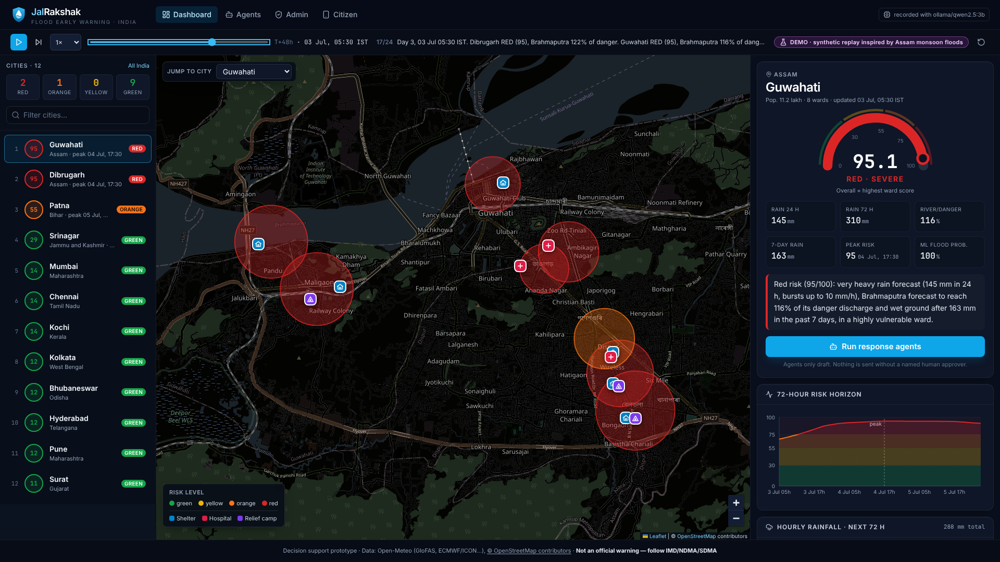
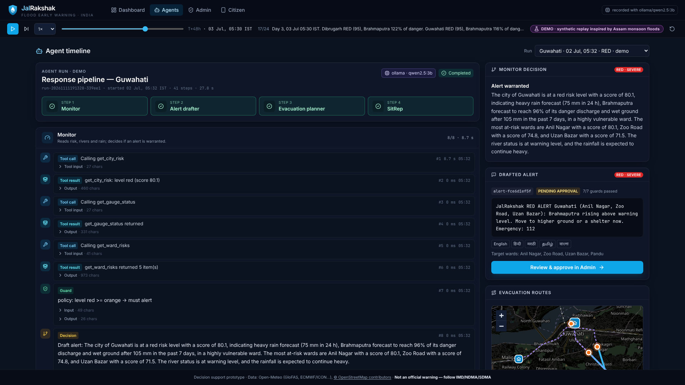
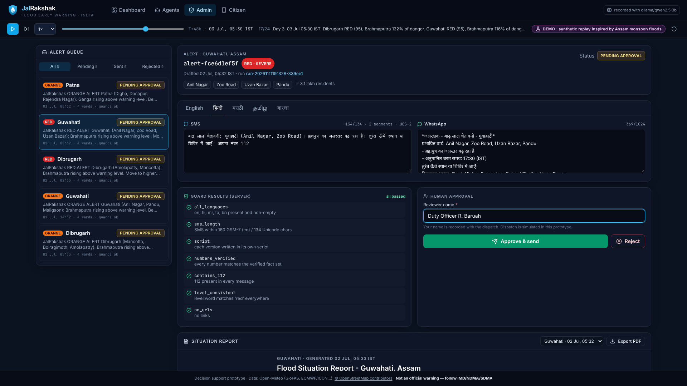
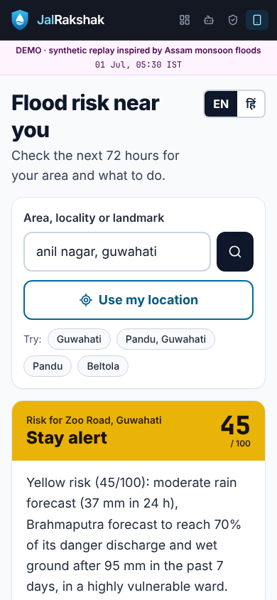
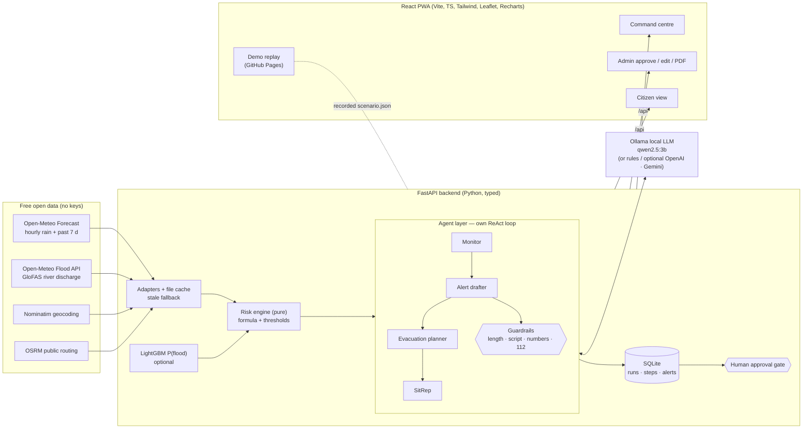

# 🌊 JalRakshak — agentic flood early warning for India

**Open forecasts → ward-level risk → multilingual alerts a human approves → people who know what to do.**

JalRakshak watches 12 flood-prone Indian cities using free open data. It computes a transparent 72-hour
flood-risk score for every ward, and runs a team of **local-LLM agents** that decide when to warn, draft
SMS/WhatsApp alerts in five languages, plan evacuation to the nearest safe shelter, and write the
district officer's situation report. **Nothing is sent without a named human approving it.** It needs
no paid services and no API keys, and runs on a laptop.

- **Live demo (no install, demo replay):** https://madhavzanwar.github.io/Jal-rakshak/
- **Demo video:** [`submission/JalRakshak_demo.mp4`](submission/JalRakshak_demo.mp4)
- **Team:** Madhav Zanwar · Divyani Papalkar — PCCoE Pune

| Command centre | Agent timeline | Human approval (5 languages) | Citizen view |
|---|---|---|---|
|  |  |  |  |

---

## The problem

India has the forecasts. CWC river levels, IMD rainfall warnings, and global models like GloFAS and ECMWF
are all available days ahead. What fails is the **last mile**. Forecasts rarely become a clear, local,
multilingual instruction that reaches a citizen in time. District control rooms are overloaded during a
monsoon, and generic warnings ("heavy rain likely") don't tell anyone which ward to leave or where to go.
Roughly 12% of India's land (about 40 million hectares) is flood-prone (NDMA), and floods recur every year
in Assam, Bihar, Mumbai, Chennai and Kerala.

## The solution

1. **Risk engine.** It pulls Open-Meteo hourly rainfall forecasts and GloFAS river discharge forecasts, then
   computes a documented, monotone **0–100 score per ward for the next 72 h**. The score is classed
   Green / Yellow / Orange / Red, with an optional **LightGBM** probability that has an honest time-split backtest.
2. **Command-centre dashboard.** It shows a risk map of India and ward zones, river-gauge cards with
   discharge against warning, danger and extreme thresholds, a 72 h rainfall chart, and a horizon chart.
   The ward drill-down shows the factor breakdown and nearest shelters.
3. **Agentic response layer.** It is our own ReAct tool-calling loop on a **local open LLM** (Ollama +
   Qwen2.5-3B):
   - **Monitor**: decides whether to alert, with a deterministic policy guard.
   - **Alert drafter**: writes SMS (≤160 chars) and WhatsApp messages in **English, हिन्दी, मराठी, தமிழ், বাংলা**,
     checked by guardrails.
   - **Evacuation planner**: finds the nearest safe shelters and hospitals, with OSRM routing and a
     straight-line fallback.
   - **SitRep**: writes the district-officer report, exported as PDF.
   - Every step is logged with its reasoning, tool inputs and outputs.
4. **Human-approval gate.** Agents can only *draft*. An officer reviews, edits and approves by name, and only
   then is the alert dispatched. Dispatch is simulated and logged.
5. **Citizen view.** Enter a place or use GPS to see your risk, what to do now, your nearest shelter with
   directions, and tap-to-call 112 / NDMA / NDRF. The citizen route is a 6 kB (gzipped) chunk, works offline
   as a PWA, and runs on low-end phones.

## Architecture



| Layer | Path | Notes |
|---|---|---|
| Data adapters | `backend/jalrakshak/adapters/` | httpx, file cache with TTL; on failure, last-known data plus `stale: true` (UI shows an amber badge) |
| Risk engine | `backend/jalrakshak/risk/` | pure functions, 43 tests including a monotonicity property grid |
| ML | `backend/jalrakshak/ml/`, `docs/MODEL.md` | LightGBM, monotone constraints, lazy-loaded, never raises |
| Agents | `backend/jalrakshak/agents/` | `llm.py` providers, `react.py` loop, `tools.py`, `guards.py`, `pipeline.py`, `store.py` |
| API | `backend/jalrakshak/api/main.py` | contract in [`docs/CONTRACT.md`](docs/CONTRACT.md) |
| Frontend | `frontend/src/` | zod-validated client; `HttpClient` and `DemoClient` share one interface |

## Data sources

| Data | Source | Use |
|---|---|---|
| Hourly precipitation forecast (+ past 7 days) | [Open-Meteo Forecast API](https://open-meteo.com/en/docs) (ECMWF / ICON / GFS blend) | rain components, antecedent wetness |
| River discharge forecast + reanalysis 1995–2024 | [Open-Meteo Flood API](https://open-meteo.com/en/docs/flood-api) — Copernicus **GloFAS** v4 | river component; P90 / P98 / P99.7 thresholds |
| Historical rainfall 1991–2024 | [Open-Meteo Archive API](https://open-meteo.com/en/docs/historical-weather-api) (ERA5) | ML training |
| Geocoding | [Nominatim](https://nominatim.org/) (cached, ≥1 s between requests, India only) | citizen search |
| Routing | [OSRM](https://project-osrm.org/) public demo | evacuation routes (straight-line fallback) |
| Map tiles | © [OpenStreetMap](https://www.openstreetmap.org/copyright) contributors | all maps |
| Wards, shelters, hospitals, phone numbers | **synthetic**, seeded and deterministic | clearly labelled; no real personal data |

## Risk formula

These are the main equations. The full version is in [`backend/RISK_FORMULA.md`](backend/RISK_FORMULA.md).

```
r24 = piecewise(max 24h rain; 15.6→0, 64.5→0.35, 115.6→0.65, 204.4 mm→1)   # IMD heavy / very heavy / extremely heavy
ri  = piecewise(max hourly intensity; 10→0, 50 mm/h→1)
r72 = piecewise(72h rain; 64.5→0, 300 mm→1)
R   = min(1, max(r24, 0.8·ri) + 0.15·r72)            # rain
D   = clamp((peak discharge / danger − 0.5) / 0.7)    # river (GloFAS)
A   = clamp(antecedent 7-day rain / 200)              # soil wetness
V   = ward vulnerability (0..1)
H   = 1 − (1−R)(1−D)                                  # rain OR river can each be severe
score = 100 · (0.75·H + 0.10·A + 0.15·V) · (0.6 + 0.4·V)
floors (V ≥ 0.5): peak ≥ warning → 55 · peak ≥ danger → 75 · peak ≥ extreme → 85
levels: green < 30 ≤ yellow < 55 ≤ orange < 75 ≤ red
```

Gauge thresholds come from each city's GloFAS cell over 1995–2024: warning = P90, danger = P98,
extreme = P99.7. These are not official CWC danger levels.

**ML (optional).** LightGBM predicts P(flood-day in the next 1–3 days), trained 1997–2018, validated
2019–20 and tested 2021–24. The flood-day label is a proxy: GloFAS discharge above P98, or 24 h rain of
115.6 mm or more. With realistic forecast noise it reaches ROC-AUC 0.990 / PR-AUC 0.859, against 0.988 / 0.787
for the rule score. At the operating threshold the gain is small (F1 0.78 vs 0.77). See
[`docs/MODEL.md`](docs/MODEL.md). We are honest that the transparent formula is the primary signal.

## Agent design and the safety gate

- **Own ReAct loop** (`agents/react.py`, no LangChain): thought → tool call → tool result → decision, up to
  6 steps. Every step is stored with its timestamp, inputs, outputs and duration, and appears in the Agent
  timeline.
- **Tools:** `get_city_risk`, `get_ward_risks`, `get_gauge_status`, `find_shelters`, `plan_route`,
  `draft_alert`, `get_emergency_contacts`, `compose_sitrep_section`.
- **Pluggable LLM:** `JR_LLM_PROVIDER=auto|ollama|openai|gemini|rules`. `auto` uses Ollama if it can reach it,
  and otherwise falls back to a deterministic **rules** provider that makes the same tool calls, so the
  system always works. Optional keys: `OPENAI_API_KEY` (plus `OPENAI_BASE_URL` for any OpenAI-compatible
  server) or `GEMINI_API_KEY`.
- **Policy guard:** the Monitor *must* alert at Orange or Red and *never* alerts on Green. The LLM supplies
  the reasoning and can escalate Yellow.
- **Multilingual safety:** a 3B model is not trusted to translate life-safety text. Hindi, Marathi, Tamil
  and Bengali come from **hand-vetted templates** filled with verified facts. English is LLM-drafted, then
  guard-checked, with a fallback to the vetted template.
- **Guardrails:** SMS length (160 GSM-7 / 134 Unicode), correct Unicode script per language, **every number in
  the text must exist in the verified fact sheet** (no hallucinated numbers), must contain 112, level word
  consistent with the level, no URLs, all five languages present.
- **Human-approval gate:** `POST /api/alerts/{id}/approve` requires a reviewer name and returns `409` if any
  guard fails. Edits re-run the guards. Approval logs the *simulated* dispatch (no SMS gateway is wired up).

## Run it

**Option A — Docker, one command** (app + Ollama; first run downloads the ~1.9 GB model):

```bash
docker compose up --build
```

Open http://localhost:8000.

**Option B — without Docker:**

```bash
ollama serve & ollama pull qwen2.5:3b          # optional – without it the rules provider is used
cd backend && make install && .venv/bin/uvicorn jalrakshak.api.main:app --port 8000
cd frontend && npm ci && npm run dev          # http://localhost:5173 (proxies /api)
```

**Option C — demo replay only (no backend, no LLM):** `cd frontend && npm ci && npm run dev:demo`, or open
the [GitHub Pages demo](https://madhavzanwar.github.io/Jal-rakshak/). It replays a **synthetic** 72 h
flood inspired by Assam monsoon floods. The agent runs in the replay were recorded from the real pipeline on
`qwen2.5:3b`.

| Env var | Default | Meaning |
|---|---|---|
| `JR_LLM_PROVIDER` | `auto` | `auto`, `ollama`, `openai`, `gemini`, `rules` |
| `JR_LLM_MODEL` | `qwen2.5:3b` | any Ollama model with tool calling |
| `OLLAMA_HOST` | `http://127.0.0.1:11434` | |
| `JR_MONITOR_INTERVAL_MIN` | `0` (off) | run the monitor on a schedule |

**Quality:** `cd backend && make lint typecheck test` · `cd frontend && npm run lint && npm run typecheck && npm test && npm run e2e`.
Results are in [`docs/QA.md`](docs/QA.md). GitHub Actions run `ci.yml` (tests) and `pages.yml` (the demo deploy).

## Limitations (honest)

- This is a **decision-support prototype**, not an official warning. Always follow IMD, CWC, NDMA and SDMA.
- Wards, populations, vulnerability, shelters and phone numbers are **synthetic**. A real deployment would use
  municipal ward GIS, census data and SDMA shelter registries.
- GloFAS thresholds are percentiles of the model's own climatology, not CWC gauge danger levels. GloFAS grid
  cells (about 5 km) can't resolve small urban streams. Mumbai is therefore scored on rain only, and pluvial
  flash flooding is captured only through rainfall.
- The ML label is a proxy (there's no open Indian flood-event database), and the backtest is optimistic
  because it uses perfect forecasts as its upper bound.
- A 3B CPU model is slow (40–150 s per full run) and its prose can be generic. That is why decisions come from
  policy guards and the Indic texts from vetted templates.
- SMS and WhatsApp dispatch is simulated. OSRM's public server only offers driving routes, so walking time is
  estimated from distance.

## Credits

Built on open source. See [CREDITS.md](CREDITS.md). Inspired by **FloodGuard** (SIH 2026),
**PredictAid** and **RescueMap-AI**. We studied their ideas and copied no code.
Licence: [MIT](LICENSE).
