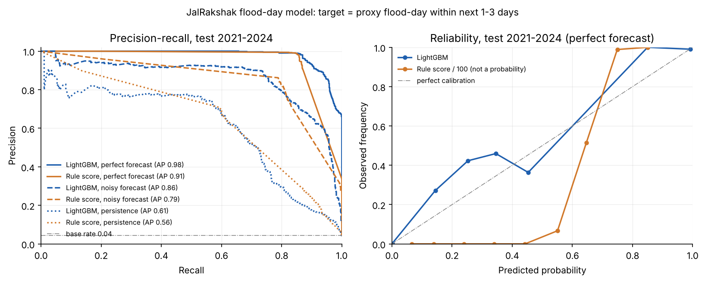

# Optional ML model: LightGBM P(flood-day in the next 1–3 days)

JalRakshak's risk score is a **transparent rule-based formula** (`backend/jalrakshak/risk/scoring.py`).
On top of it, an **optional** LightGBM classifier fills `RiskScore.ml_probability`. If `lightgbm`
is not installed or the model file is missing, the field is `null` and nothing else changes.
The rule score stays the source of truth for alert levels. The model is shown as a second
opinion.

> **Summary.** On a proxy label, with a time-based split, the model ranks and calibrates
> slightly better than the rule score. At a matched operating point the gain is small, and with a
> poor forecast it disappears: ROC-AUC is the same and F1 is within 0.01. These numbers do
> **not** measure how well either method detects real floods. See [Limitations](#limitations).

## Data

| What | Source | Resolution | Period used |
|---|---|---|---|
| River discharge | Open-Meteo Flood API (`flood-api.open-meteo.com/v1/flood`): **GloFAS v4 reanalysis**, `river_discharge` | daily, 0.05° grid | 1997-01-01 → 2024-12-31 (values before 1997 come back as null) |
| Rainfall | Open-Meteo Historical Weather API (`archive-api.open-meteo.com/v1/archive`): **ERA5 / ERA5-Land reanalysis** (`best_match`), `precipitation` | **hourly**, local time (Asia/Kolkata) | 1991-01-01 → 2024-12-31 |

* The archive API was slow (about 70 s for the first request, and some requests took minutes),
  but it worked with long timeouts and 5-year chunks. The fallback APIs (historical-forecast and
  forecast with `past_days`) were **not needed**.
* Requests run one after another, are spaced out, and are cached as raw JSON in
  `backend/var/ml_cache/` (gitignored, about 85 MB). With a warm cache, a re-run makes no
  network calls.
* **Rainfall point:** the city-centre coordinates (`jalrakshak/ml/dataset.py: CITIES`).
* **Discharge point:** the primary gauge cell for each city from `backend/jalrakshak/data/gauges.json`
  (cell = the largest mean discharge in a small candidate grid). Its `warning/danger/extreme`
  thresholds are GloFAS P90/P98/P99.7. Using this file means `discharge_ratio` is computed exactly
  as at runtime. **Mumbai has no gauge** in that file (all nearby cells have P98 < 50 m³/s), so for
  Mumbai `discharge_ratio = 0` and its label is rain-only, which is what runtime does.
  If `gauges.json` is missing, `dataset.probe_river_cell` probes a grid around a river hint point
  with a single multi-location request and keeps the cell with the largest mean discharge.

| City | River cell (lat, lon) | danger (m³/s) | label P98 (1997–2018) |
|---|---|---|---|
| Mumbai | – (no gauge) | – | – |
| Chennai | Adyar 13.01, 80.24 | 92 | 85 |
| Guwahati | Brahmaputra 26.19, 91.64 | 45 548 | 45 708 |
| Patna | Ganga 25.63, 85.10 | 39 806 | 40 178 |
| Kochi | Periyar 10.11, 76.30 | 748 | 704 |
| Srinagar | Jhelum 34.12, 74.70 | 464 | 453 |
| Kolkata | Hooghly 22.57, 88.29 | 2 390 | 2 494 |
| Bhubaneswar | Mahanadi 20.43, 85.98 | 13 520 | 13 252 |
| Surat | Tapi 21.15, 72.77 | 3 710 | 3 305 |
| Hyderabad | Musi 17.37, 78.53 | 112 | 92 |
| Pune | Mula-Mutha 18.53, 73.92 | 648 | 610 |
| Dibrugarh | Brahmaputra 27.50, 94.82 | 24 265 | 24 043 |

## Label (a proxy, not observed floods)

No database of real flood events (with dates and cities) is available offline, so the label is a
**hydro-meteorological proxy**:

* **flood-day** (for each city and local calendar day) =
  GloFAS discharge at the gauge cell **> P98 of its 1997–2018 climatology** (training period only,
  so no test-period information leaks into the label),
  **OR** daily rain ≥ **115.6 mm** (IMD "very heavy").
* **Target** for issue day *d* = whether a flood-day occurs on **d+1, d+2 or d+3**. This is a
  72 h forecast, not a nowcast.

Base rate: 2.8 % of training rows and 4.4 % of validation and test rows are positive.
Almost all positives come from the river condition. ERA5 is a 0.1–0.25° reanalysis that heavily
smooths convective extremes, so ≥115.6 mm days are very rare in it: about 0.1 % of days, and
0.2 % for Mumbai, where real gauges record such days several times each monsoon. As a result,
the rain arm of the label is badly under-sampled.

## Features

These match the RiskFactors raw fields, so they can be computed at runtime from the same 72 h
window the rule score uses (`jalrakshak.ml.features.FEATURE_ORDER`):

| Feature | Training (issue day d) | Runtime |
|---|---|---|
| `rain_24h_mm` | max rolling-24 h sum ending on d+1..d+3 (hourly ERA5) | max rolling 24 h in the 72 h forecast |
| `rain_72h_mm` | rain total for d+1..d+3 | 72 h forecast total |
| `max_intensity_mmph` | max hourly rain for d+1..d+3 (real hourly data, not approximated) | max forecast hourly rain |
| `antecedent_7d_mm` | observed rain for d-6..d | observed past 7 days |
| `discharge_ratio` | max discharge for d+1..d+3 / gauge `danger_m3s` (0 if no gauge) | forecast 72 h peak / danger |
| `vulnerability` | constant 0.5 (history has no ward data) | ward vulnerability |
| `month_sin`, `month_cos` | calendar month of d | the `month` key in the features dict, else the current UTC month |

**"Perfect forecast" training.** The forward-looking features use the *realised* rain and
discharge for the next 72 h. Training and the headline metrics therefore assume a perfect
forecast. This is an **upper bound**: at runtime the inputs are NWP and GloFAS forecasts, and
forecast error lowers the scores. To show how much, the backtest also scores both models with
degraded inputs (see below).

Because the label is a threshold on discharge and rain, and the features include the realised
discharge and rain, the perfect-forecast task is **close to circular** (a feature such as
`discharge_ratio > ~1` almost decides the label). The near-perfect AUCs below reflect this. They
are not evidence of real forecasting skill.

LightGBM settings: `num_leaves=15`, `min_data_in_leaf=200`, `learning_rate=0.03`,
early stopping on validation (266 trees, 343 kB). **Monotone constraints** make the prediction
non-decreasing in all rain, antecedent and discharge features, so it can never say that more
rain lowers the risk. Vulnerability is constant in training, so the model ignores it, and any
ward-level variation in `ml_probability` comes from the other features. Gain importance:
`discharge_ratio` ≫ `rain_24h_mm` > `rain_72h_mm` > `antecedent_7d_mm` > month > intensity.

## Split and protocol

* **Time-based split:** train 1997–2018 (Mumbai rain-only from 1991; 98 617 rows), validate
  2019–2020 (8 772), test 2021–2024 (17 496). All 12 cities are in each split, and the model is
  shared across cities.
* The decision threshold is chosen on **validation** as the threshold with the highest F1:
  LightGBM p ≥ **0.383**. The same procedure gives a rule-score cut-off of **56**, reported next
  to the product's fixed orange cut-off of **55**.
* **Baseline** = the production `jalrakshak.risk.scoring.score_ward` called directly, with
  vulnerability 0.5 and the gauge's warning/danger/extreme thresholds (river floors included).
  For AUC and Brier, score/100 is used as a pseudo-probability. It is not calibrated, so its
  Brier score is reported for completeness only.
* **Forecast-quality scenarios** on the test period, with the same perturbed inputs fed to both
  models:
  * **perfect**: realised next-72 h values (upper bound);
  * **noisy**: multiplicative log-normal error, one draw per day; rain σ=0.6 (median −16 %,
    since NWP under-forecasts extremes), discharge σ=0.15;
  * **persistence**: the previous 72 h used as the "forecast" (no-skill lower bound).

## Results (test 2021–2024, n = 17 496, base rate 4.4 %)

| Scenario | Model | ROC-AUC | PR-AUC | Brier | P / R / F1 @ val threshold | P / R / F1 @ fixed cut |
|---|---|---|---|---|---|---|
| perfect | **LightGBM** | **0.999** | **0.979** | **0.005** | 0.95 / 0.89 / **0.92** (p≥0.383) | 0.97 / 0.87 / 0.92 (p≥0.5) |
| perfect | Rule score | 0.994 | 0.909 | 0.041* | 0.91 / 0.87 / 0.89 (≥56) | 0.34 / 1.00 / 0.50 (≥55) |
| noisy | **LightGBM** | 0.990 | **0.859** | **0.016** | 0.74 / 0.83 / 0.78 | 0.76 / 0.82 / 0.79 (p≥0.5) |
| noisy | Rule score | 0.988 | 0.787 | 0.046* | 0.73 / 0.83 / 0.77 (≥56) | 0.32 / 0.99 / 0.48 (≥55) |
| persistence | LightGBM | 0.944 | **0.608** | **0.028** | 0.66 / 0.61 / 0.63 | 0.67 / 0.60 / 0.63 (p≥0.5) |
| persistence | Rule score | **0.947** | 0.561 | 0.051* | 0.64 / 0.62 / 0.63 (≥56) | 0.29 / 0.87 / 0.44 (≥55) |

\* The rule score is not a probability, so its Brier score is shown for reference only.
Validation 2019–2020 (perfect): LightGBM PR-AUC 0.986 vs rule 0.924.



**Per city (test, perfect forecast; PR-AUC, and F1 at the threshold chosen on validation / at
score 55):**

| City | positives | LightGBM PR-AUC | Rule PR-AUC | LightGBM F1 | Rule F1 @55 | Persistence PR-AUC (LGBM / rule) |
|---|---|---|---|---|---|---|
| Mumbai (rain only) | 6 | 0.80 | 0.48 | 0.71 | 0.55 | 0.01 / 0.01 |
| Chennai | 77 | 1.00 | 0.99 | 1.00 | 0.42 | 0.61 / 0.45 |
| Guwahati | 27 | 1.00 | 0.97 | 0.95 | 0.36 | 0.46 / 0.38 |
| Patna | 30 | 1.00 | 1.00 | 0.94 | 0.31 | 0.77 / 0.60 |
| Kochi | 104 | 1.00 | 0.93 | 0.96 | 0.58 | 0.78 / 0.71 |
| Srinagar | 77 | 1.00 | 0.96 | 0.96 | 0.68 | 0.73 / 0.67 |
| Kolkata | 20 | 1.00 | 0.88 | 0.82 | 0.28 | 0.80 / 0.71 |
| Bhubaneswar | 44 | 1.00 | 0.98 | 0.98 | 0.43 | 0.63 / 0.60 |
| Surat | 96 | 0.99 | 0.90 | 0.91 | 0.55 | 0.84 / 0.70 |
| Hyderabad | 182 | 1.00 | 0.86 | 0.84 | 0.67 | 0.77 / 0.68 |
| Pune | 74 | 1.00 | 0.90 | 0.94 | 0.50 | 0.53 / 0.43 |
| Dibrugarh | 30 | 0.99 | 0.97 | 0.87 | 0.32 | 0.18 / 0.17 |

Every number is in `backend/models/backtest.json` (validation metrics, thresholds, alert rates
and per-city persistence results are included).

### What these results show and what they don't

* **Ranking and calibration:** LightGBM has a higher PR-AUC in every scenario (+0.05 to +0.07)
  and is much better calibrated, as you would expect from a fitted model compared with a
  hand-weighted score.
* **At a matched operating point the gain is small.** Once the rule cut-off is tuned on
  validation (56), the F1 gap is +0.03 with a perfect forecast, +0.01 with a noisy one and
  **≈0 with persistence**, where the rule even has a slightly higher ROC-AUC. **With realistic
  forecast error, the ML model is not clearly better than the transparent rule.**
* **The product's fixed cut-off of 55 alerts much more often** (precision about 0.3, recall about
  1.0, alert rate about 15 % on validation). This is not a fault in the formula. It is the
  designed river floor: with vulnerability ≥ 0.5 and discharge ≥ warning (P90), the score is at
  least 55. That is a deliberate high-recall choice for a public-safety tool, and the
  orange-to-red cut-off of 75 is where it becomes selective. For alert decisions, keep the
  rule's levels and treat `ml_probability` as a confidence signal.
* With perfect inputs, both methods score above 0.99 ROC-AUC because the task is near-circular
  (see Features). The useful comparison is the noisy and persistence rows. Even the persistence
  numbers are flattering: large rivers such as the Ganga and the Brahmaputra change slowly, so
  yesterday's discharge is a strong predictor of tomorrow's. The flashy and rain-driven cases
  (Mumbai, Dibrugarh) score close to chance without a forecast.

## Limitations

1. **Proxy label.** Exceeding GloFAS P98, or ERA5 rain ≥ 115.6 mm, is not the same as an observed
   urban flood. Urban pluvial flooding (Mumbai, Chennai, Hyderabad) is mostly missed, because
   reanalysis rainfall is far too smooth and urban drainage is not modelled. Some exceedances
   of P98 at a large river cell cause no damage in the city.
2. **Perfect-forecast training.** The main metrics are an upper bound. The noisy and persistence
   scenarios bracket realistic performance, and the noise model is crude (not calibrated against
   real IMD/ECMWF or GloFAS forecast error).
3. **Circularity.** Features and label come from the same series. The model mostly learns the
   P98 threshold and the rain threshold, and is not evidence of new physical skill.
4. **Threshold leakage (minor).** `gauges.json` sets `danger_m3s` from 1995–2024 percentiles,
   which include the test years. The label P98 itself uses only 1997–2018.
5. **Small effective sample.** About 770 positive test days come from a few dozen flood
   episodes. Days within an episode are highly correlated, so the confidence intervals are wide.
   Mumbai has 6 positive test days.
6. **Vulnerability is constant (0.5) in training**, so the model cannot learn a ward effect.
   Ward differences in `ml_probability` come only from the other features.
7. **Single shared model.** It is not tuned per city, and cities without a gauge (Mumbai) rely on
   rain only.
8. The rolling-24 h window in training can include up to 23 h from the day before the window.
   This is a small bias compared with the runtime definition.

## Runtime use

```python
from jalrakshak.ml import flood_probability, model_info

p = flood_probability("guwahati", {
    "rain_24h_mm": 80, "rain_72h_mm": 150, "max_intensity_mmph": 20,
    "antecedent_7d_mm": 120, "discharge_ratio": 0.95, "vulnerability": 0.6,
    # optional: "month": 7
})  # -> float in [0, 1], or None if lightgbm / the model is unavailable
```

* The model loads lazily and thread-safely once per process. Any failure (missing package,
  missing or corrupt file, feature mismatch, bad input) is logged and returns `None`.
* The signature matches `assess.MLFn`, and `scoring.ml_features()` produces the expected keys.
* Artefacts are in `backend/models/` (override with `JR_MODEL_DIR`): `flood_lgbm.txt` (LightGBM
  text dump), `model_meta.json` (feature order, threshold, date ranges, headline metrics),
  `backtest.json`.

## How to retrain

```bash
cd backend
pip install -e '.[ml]'          # lightgbm, scikit-learn, pandas, matplotlib
python scripts/train_model.py   # ~15 min the first time (downloads), ~10 s with a warm cache
pytest tests/test_ml.py
```

The script fetches or reads the cache, builds the dataset, trains, runs the backtest and writes
`backend/models/{flood_lgbm.txt,model_meta.json,backtest.json}` and `docs/img/model_pr_curve.png`.
Training is deterministic (fixed seed, `deterministic=True`). To change the split, edit
`TRAIN_END/VAL_*/TEST_START` in the script. To change the label, edit `DISCHARGE_PERCENTILE` /
`CLIMATOLOGY_END` in `jalrakshak/ml/dataset.py`. Delete `backend/var/ml_cache/` to force fresh
downloads.
